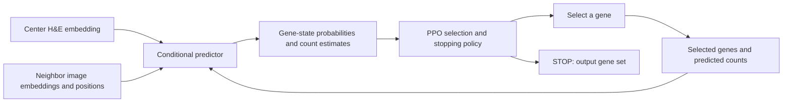

# HE-Gene-RL

[中文说明](README.zh-CN.md)

HE-Gene-RL predicts an expressed-gene set for each cell from H&E image embeddings and spatial context. A conditional predictor combines the center cell, neighboring image embeddings, and previously selected genes with their predicted counts. A PPO policy chooses the next gene or stops.

Inference requires image embeddings and coordinates, not measured gene expression. The project consumes precomputed embeddings; image preprocessing and UNI feature extraction are outside this package.

**Status: full standalone training and test-set evaluation completed on 2026-11-13.** The package rebuilt its data directly from the external Rank datasets and trained all three stages from scratch for Rep1/Rep2 with seeds 42, 43, and 44. Across the three sequence methods shared with the historical experiment, all **192 compared metrics match exactly** (48 aggregate and 144 per-seed values; maximum absolute difference 0). See [the reproduction summary](reports/reproduction_20261113.json) and [results](docs/results.md).

Evaluation covered four source/target directions, 4,096 test cells per direction, 313 genes, and five method variants. PPO reduced cost relative to the adapted predictor's fixed sequence rule by 0.19% and 0.32% in the two cross-section directions. The pretrained one-shot predictor still had lower cost in both directions; these results do not establish an advantage of sequence RL over one-shot prediction.

## Method



Training has three stages:

1. **Conditional pretraining:** train the predictor on empty histories and randomly sampled histories containing measured source-training counts.
2. **Predicted-history adaptation:** generate histories with the predictor's own count estimates and adapt the predictor using supervised targets for the remaining genes.
3. **PPO optimization:** freeze the adapted predictor and train the selection/stopping policy. Build trajectories using predicted counts, then use training expression to assign rewards.

The classification head predicts the three outcomes `count = 0`, `count = 1`, and `count >= 2`. The count head predicts `log(1 + count)`. The supervised loss is three-class cross-entropy plus `0.1` times log-count mean squared error; count-one targets are excluded from the regression term. PPO receives `-1`, `0`, or `+2` when selecting a gene with a true count of zero, one, or at least two. STOP has zero reward. With no discounting, maximizing return is equivalent to minimizing `FP + 2 FN` for each cell.

See [docs/method.md](docs/method.md) for the precise state, loss, reward, and training boundaries.

## Install

Use Python 3.10 or newer with NumPy, SciPy, and PyTorch 2.7 or newer, as declared in [pyproject.toml](pyproject.toml). Install the appropriate PyTorch build for your machine, then install this package from its root:

```bash
python -m pip install -e '.[test]'
```

The commands below describe the supported workflows. The completed run used the existing `HERL` Conda environment; its full command sequence is recorded in [docs/reproduction.md](docs/reproduction.md).

## Prepare data

Provide a JSON manifest pointing to image banks and named cell splits. All relative paths are resolved against the manifest's directory. Each bank contains image embeddings, cell identities, image coordinates, and ordered gene identities. Training splits additionally contain raw count targets; prediction-only splits do not need counts.

Use [examples/data_manifest.json](examples/data_manifest.json) as a template and [docs/data_format.md](docs/data_format.md) for array shapes, split requirements, and label-free deployment.

To rebuild the historical data partitions directly from an external Rank `datasets` directory, use the standalone preparation code:

```bash
python scripts/prepare_rank_data.py \
  --datasets-root ../datasets --source-variant with-spatialex \
  --output data
```

This reads raw counts, UNI features, coordinates, and cell/gene identities. It reconstructs the historical partitions without loading old outputs or importing Rank modules. `with-spatialex` selects the source filenames used in the historical experiment; their prediction layers are ignored. Preparation requires `h5py`, included in the `data` and `test` optional dependencies.

Alternatively, an existing Rank workspace's prepared data can be exported:

```bash
python scripts/export_legacy_data.py --rank-root .. --output data
```

Choose one preparation route for a new output directory. Normal training and inference use the resulting portable manifest and this package.

## Train

```bash
he-gene-rl train \
  --config configs/default.json \
  --data data/manifest.json \
  --output runs/main
```

The default training command runs pretraining, adaptation, and PPO. The `--stage` option selects `pretrain`, `adapt`, `ppo`, or `all`; later stages require their preceding checkpoints. Source monitor data select checkpoints. Test expression is not used for fitting, normalization, or checkpoint selection.

To reuse local historical checkpoints instead of retraining them:

```bash
python scripts/import_legacy_artifacts.py --rank-root .. --output runs/legacy
```

Check [docs/reproduction.md](docs/reproduction.md) for the distinction between importing an existing run and training a new one.

## Predict, then evaluate

Prediction does not load expression targets, including when they are present in the split archive:

```bash
he-gene-rl predict \
  --run runs/main \
  --data data/manifest.json \
  --source Rep1 --target Rep2 --seed 42 --split test \
  --output predictions/Rep1_to_Rep2_seed42.npz \
  --device cpu
```

`--method` defaults to `ppo_sequence`. Other choices are `adapted_sequence`, `teacher_sequence`, `teacher_one_shot`, and `adapted_one_shot`; these use the corresponding predictor checkpoints from the same run. `--batch-size` defaults to 512.

Only the separate evaluation command needs true expression:

```bash
he-gene-rl evaluate \
  --predictions predictions/Rep1_to_Rep2_seed42.npz \
  --data data/manifest.json --target Rep2 --split test \
  --output results/Rep1_to_Rep2_seed42.json
```

To evaluate the configured trained models and comparison variants in a run:

```bash
he-gene-rl evaluate-run \
  --run runs/main --data data/manifest.json \
  --output results/main --device cuda
```

By default, run-level evaluation includes all five method variants. Use `--methods` to select a subset. It completes all requested predictions before reading expression targets for scoring.

An external method can be compared by supplying an aligned final-selection archive:

```bash
he-gene-rl compare \
  --candidate predictions/Rep1_to_Rep2_seed42.npz \
  --reference predictions/external_baseline.npz \
  --data data/manifest.json --target Rep2 --split test \
  --output results/ppo_vs_external.json
```

Both archives need a boolean `selected_mask` (or `selected`), unique `cell_ids`, and the complete ordered `gene_ids`. Cell order is aligned automatically; gene order must already match the dataset. See [the prediction archive format](docs/data_format.md#prediction-and-external-baseline-archives). The comparison reports paired differences and, where spatial blocks permit, spatial-block confidence intervals. The completed reproduction evaluated the five internal variants; external comparisons require separately prepared predictions.

The package contains the proposed method and its internal variants. It does not contain a standalone implementation or retraining pipeline for SpatialEx or the historical STRank baseline. Historical baseline scores are recorded in [docs/results.md](docs/results.md).

## Project layout

```text
configs/                 Training configuration
examples/                Portable manifest example
src/he_gene_rl/
  model.py               Conditional predictor and supervised loss
  pretraining.py         Supervised training with random measured histories
  adaptation.py          Supervised adaptation to self-predicted histories
  ppo.py                 Actor/critic, rewards, and PPO updates
  core.py                Label-free sequence transitions and final metrics
  data.py                Portable data loading and source normalization
  preparation.py         Direct H5ad loading and historical split reconstruction
  information.py         Conditional prediction diagnostics and statistics
scripts/                 Direct data preparation and optional migration helpers
tests/                   Unit tests and data-contract checks
docs/                    Method, data, results, reproduction
reports/                 Historical aggregates and standalone reproduction summary
```

Run `python -m pytest` for the unit tests. The reproduction summary records completed training and test-set evaluation; it does not include a saved unit-test terminal report or a unit-test pass count.

## Publishing

Data banks, model checkpoints, prediction archives, and local run directories are excluded by `.gitignore`. The small historical aggregate and standalone reproduction summaries accompany the code. Checkpoints and datasets can be distributed separately if desired and permitted by their source terms.

The source code is distributed under the [MIT License](LICENSE). Dataset and checkpoint distribution remains subject to the applicable source terms.
