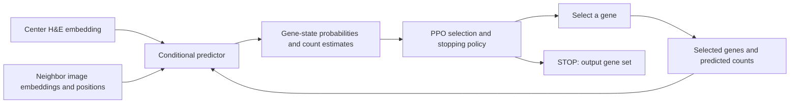

# HE-Gene-RL

[中文说明](README.zh-CN.md)

HE-Gene-RL predicts an expressed-gene set for each cell from H&E image embeddings and spatial context. A conditional predictor combines the center cell, neighboring image embeddings, and previously selected genes with their predicted counts. A PPO policy chooses the next gene or stops.

Inference requires image embeddings and coordinates, not measured gene expression. The project consumes precomputed embeddings; image preprocessing and UNI feature extraction are outside this package.

**Status:** the original experiment has completed training and evaluation. This standalone project is a code reorganization, and its tests, training, and inference have deliberately not been run during this packaging step. Historical results are documented separately in [docs/results.md](docs/results.md); they are not validation of this package.

## Method



Training has three stages:

1. **Conditional pretraining:** train the predictor on empty histories and randomly sampled histories containing measured source-training counts.
2. **Predicted-history adaptation:** generate histories with the predictor's own count estimates and adapt the predictor using supervised targets for the remaining genes.
3. **PPO optimization:** freeze the adapted predictor and train the selection/stopping policy. Build trajectories using predicted counts, then use training expression to assign rewards.

The classification head predicts the three outcomes `count = 0`, `count = 1`, and `count >= 2`. The count head predicts `log(1 + count)`. The supervised loss is three-class cross-entropy plus `0.1` times log-count mean squared error; count-one targets are excluded from the regression term. PPO receives `-1`, `0`, or `+2` when selecting a gene with a true count of zero, one, or at least two. STOP has zero reward. With no discounting, maximizing return is equivalent to minimizing `FP + 2 FN` for each cell.

See [docs/method.md](docs/method.md) for the precise state, loss, reward, and training boundaries.

## Install

Use Python 3.10 or newer with NumPy, SciPy, and PyTorch 2.7 or newer, as declared in [pyproject.toml](pyproject.toml). Install the appropriate PyTorch build for your machine, then install this package from its root:

```bash
python -m pip install -e '.[test]'
```

The commands below are prepared entry points for subsequent use. They have not been executed as part of this reorganization.

## Prepare data

Provide a JSON manifest pointing to image banks and named cell splits. All relative paths are resolved against the manifest's directory. Each bank contains image embeddings, cell identities, image coordinates, and ordered gene identities. Training splits additionally contain raw count targets; prediction-only splits do not need counts.

Use [examples/data_manifest.json](examples/data_manifest.json) as a template and [docs/data_format.md](docs/data_format.md) for array shapes, split requirements, and label-free deployment.

If the original Rank workspace is available locally, its data can be exported without importing that project's Python modules:

```bash
python scripts/export_legacy_data.py --rank-root .. --output data
```

The original workspace is needed only for this migration helper. Normal training and inference use the portable manifest and this package.

## Train

```bash
he-gene-rl train \
  --config configs/default.json \
  --data data/manifest.json \
  --output runs/main
```

The default training command runs pretraining, adaptation, and PPO. The `--stage` option selects `pretrain`, `adapt`, `ppo`, or `all`; later stages require their preceding checkpoints. Source monitor data select checkpoints. Test expression is not used for fitting, normalization, or checkpoint selection.

To reuse local historical checkpoints instead of retraining them:

```bash
python scripts/import_legacy_artifacts.py --rank-root .. --output runs/legacy
```

Check [docs/reproduction.md](docs/reproduction.md) for the distinction between importing an existing run and training a new one.

## Predict, then evaluate

Prediction does not load expression targets, including when they are present in the split archive:

```bash
he-gene-rl predict \
  --run runs/main \
  --data data/manifest.json \
  --source Rep1 --target Rep2 --seed 42 --split test \
  --output predictions/Rep1_to_Rep2_seed42.npz \
  --device cpu
```

`--method` defaults to `ppo_sequence`. Other choices are `adapted_sequence`, `teacher_sequence`, `teacher_one_shot`, and `adapted_one_shot`; these use the corresponding predictor checkpoints from the same run. `--batch-size` defaults to 512.

Only the separate evaluation command needs true expression:

```bash
he-gene-rl evaluate \
  --predictions predictions/Rep1_to_Rep2_seed42.npz \
  --data data/manifest.json --target Rep2 --split test \
  --output results/Rep1_to_Rep2_seed42.json
```

To evaluate the configured trained models and comparison variants in a run:

```bash
he-gene-rl evaluate-run \
  --run runs/main --data data/manifest.json \
  --output results/main --device cuda
```

By default, run-level evaluation includes all five method variants. Use `--methods` to select a subset. It completes all requested predictions before reading expression targets for scoring.

An external method can be compared by supplying an aligned final-selection archive:

```bash
he-gene-rl compare \
  --candidate predictions/Rep1_to_Rep2_seed42.npz \
  --reference predictions/external_baseline.npz \
  --data data/manifest.json --target Rep2 --split test \
  --output results/ppo_vs_external.json
```

Both archives need a boolean `selected_mask` (or `selected`), unique `cell_ids`, and the complete ordered `gene_ids`. Cell order is aligned automatically; gene order must already match the dataset. See [the prediction archive format](docs/data_format.md#prediction-and-external-baseline-archives). The comparison reports paired differences and, where spatial blocks permit, spatial-block confidence intervals. A new performance claim requires actually running and checking these commands; this package does not infer new results from the historical report.

The package contains the proposed method and its internal variants. It does not contain a standalone implementation or retraining pipeline for SpatialEx or the historical STRank baseline. Historical baseline scores are recorded in [docs/results.md](docs/results.md).

## Project layout

```text
configs/                 Training configuration
examples/                Portable manifest example
src/he_gene_rl/
  model.py               Conditional predictor and supervised loss
  pretraining.py         Supervised training with random measured histories
  adaptation.py          Supervised adaptation to self-predicted histories
  ppo.py                 Actor/critic, rewards, and PPO updates
  core.py                Label-free sequence transitions and final metrics
  data.py                Portable data loading and source normalization
  information.py         Conditional prediction diagnostics and statistics
scripts/                 Optional migration helpers for the original workspace
tests/                   Tests reserved for the next verification stage
docs/                    Method, data, historical results, reproduction
reports/                 Small historical aggregate records
```

The next verification stage can start with `python -m pytest`. No test-passing badge or reproduction claim is made for this reorganized version.

## Publishing

Data banks, model checkpoints, prediction archives, and local run directories are excluded by `.gitignore`. The small historical aggregate report can accompany the code. Checkpoints and datasets can be distributed separately if desired and permitted by their source terms.

No software license has been selected for this repository yet. Choose the intended license before offering it for reuse. No author list, paper DOI, or GitHub repository URL is assumed by this package.
